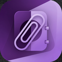

# 🧠 ClipVault

<div align="center">
  

  **Your Memory Companion**

  *A clipboard manager for Linux that remembers everything you copy — text, links, images, files and folders.*

  [](https://github.com/j-c-fstk-dev/clipvault/actions/workflows/ci.yml)
  [](https://github.com/j-c-fstk-dev/clipvault/releases)
  [](LICENSE)
  [](https://v2.tauri.app/)
  [](https://www.rust-lang.org/)
  [](https://react.dev/)

</div>

---

> **Status:** early development — the first release is 0.1.0. See the
> [Roadmap](#-roadmap) for what comes next.

## ✨ Features

- **Real-time capture** on X11 — event driven, no polling — of text, HTML,
  images and files/folders copied in your file manager
- **File snapshots** — copied files are also saved in the vault (up to 25 MB
  per copy by default), so they survive being moved or deleted
- **Persistent history** in SQLite; copying something again moves it to the
  top instead of duplicating it; oldest items are pruned past the limit
  (favorites are always kept)
- **Copy anything back** — text (with formatting), images, and files you can
  paste straight into your file manager; if the original file was moved or
  deleted, the saved copy is pasted instead
- **Privacy** — content marked secret by password managers (e.g. KeePassXC)
  is never stored, and capture can be paused
- **Always at hand** — lives in the tray; `Ctrl+Shift+V` (configurable)
  brings it up from anywhere, arrow keys pick an item and `Ctrl+C` copies it
  and gets out of the way so you can paste
- **Starts with your session** (optional), hidden in the tray; optional
  desktop notifications for new items
- **Backups** — export the whole history (images and saved file copies
  included) to a `.zip` and import it on another machine; importing merges,
  it never replaces
- **Category tabs** — text, links, images, files and folders, plus an "All" view
- **Grid and list views**, sorting by date or name, instant search over
  content, file paths and tags, smooth scrolling through large histories
- **Favorites and custom tags** to organize what matters
- **Light and dark themes** with 12 accent colors
- **Full-screen preview** with metadata and quick actions
- **Native and lightweight** — Rust backend with the system WebKitGTK, ~2 MB `.deb`

### Keyboard

| Keys | Action |
|---|---|
| `Ctrl+Shift+V` | Show / hide ClipVault from anywhere |
| `↑` `↓` `←` `→` | Select an item |
| `Enter` | Open the selected item |
| `Ctrl+C` | Copy the selected item and hide ClipVault |
| `Delete` | Delete the selected item |
| `Esc` | Close the preview, or hide ClipVault |

The show/hide, copy and delete shortcuts can be changed in Settings.

### Where data lives

| What | Path |
|---|---|
| History database | `~/.local/share/com.jorgecristo.clipvault/clipvault.db` |
| Images and file snapshots | `~/.local/share/com.jorgecristo.clipvault/blobs/` |
| Settings | `~/.config/com.jorgecristo.clipvault/settings.json` |

## 📦 Install

Download the latest `.deb` or `.AppImage` from the
[Releases](https://github.com/j-c-fstk-dev/clipvault/releases) page.

```bash
# Debian / Ubuntu / Kali
sudo apt install ./clipvault_<version>_amd64.deb

# Any distro
chmod +x clipvault_<version>_amd64.AppImage
./clipvault_<version>_amd64.AppImage

# Optional: verify the download (SHA256SUMS is attached to each release)
sha256sum -c SHA256SUMS --ignore-missing
```

Currently targeting **X11** desktops (XFCE, MATE, Cinnamon, KDE on X11…).
Wayland support is on the roadmap.

## 🛠️ Development

### Prerequisites

- [Rust](https://rustup.rs/) (stable)
- Node.js 20+ and npm
- System libraries (Debian / Ubuntu / Kali):

```bash
sudo apt install libwebkit2gtk-4.1-dev libgtk-3-dev libayatana-appindicator3-dev \
  librsvg2-dev libxdo-dev libssl-dev build-essential curl wget file patchelf
```

### Run

```bash
npm install
npm run tauri dev       # desktop app with hot reload
npm run tauri build     # .deb + .AppImage in src-tauri/target/release/bundle/
```

### Checks (same as CI)

```bash
npm run lint && npm run build
cd src-tauri && cargo fmt --check && cargo clippy --all-targets -- -D warnings && cargo test
```

The clipboard integration tests (capture and paste) need an X server and
`xclip`; they are skipped without them. To run them headless:
`sudo apt install xvfb xclip && xvfb-run -a cargo test`.

Set `RUST_LOG=clipvault_lib=debug` for verbose backend logs.

### Project structure

```
clipvault/
├── src/                     # React + TypeScript UI
│   ├── components/          # Header, Sidebar, views, modal, settings
│   ├── hooks/               # useClipboard, useSettings, useTheme
│   ├── lib/backend.ts       # Typed calls to the Rust commands
│   └── types/               # Shared types
├── src-tauri/               # Rust backend (Tauri 2)
│   ├── src/
│   │   ├── capture.rs       # X11 clipboard watcher (XFixes, INCR)
│   │   ├── serve.rs         # Copying items back (selection owner, INCR)
│   │   ├── desktop.rs       # Tray, global shortcut, notifications
│   │   ├── autostart.rs     # ~/.config/autostart entry
│   │   ├── backup.rs        # .zip export / import
│   │   ├── store.rs         # SQLite history, images, file snapshots
│   │   ├── model.rs         # Item types and parsing helpers
│   │   ├── settings.rs      # settings.json
│   │   ├── commands.rs      # Commands called by the UI
│   │   └── lib.rs           # App setup
│   ├── tests/               # X11 capture / paste integration tests
│   ├── capabilities/        # Window permissions
│   ├── icons/               # App icons
│   └── tauri.conf.json      # App and bundle config
├── scripts/                 # Versioning, release notes, smoke test
└── .github/workflows/       # CI and releases
```

### Tech stack

- **Backend:** Rust + [Tauri 2](https://v2.tauri.app/)
- **UI:** React 18, TypeScript, Tailwind CSS, Lucide icons, Vite
- **Packaging:** Tauri bundler (`.deb`, `.AppImage`)

## 📋 Roadmap

- [x] **Stage 1 — Foundation:** Tauri 2 app, AGPL-3.0, CI
- [x] **Stage 2 — Core:** X11 clipboard watcher (text, HTML, images, files), dedup, SQLite history, file snapshots, password-manager filtering
- [x] **Stage 3 — UI wiring:** real data instead of mocks, copy back any format, persistent settings
- [x] **Stage 4 — System:** tray, global shortcut, autostart, notifications
- [x] **Stage 5 — Backup:** `.zip` export / import with merge
- [x] **Stage 6 — Releases:** tag → GitHub Release with `.deb` + `.AppImage`
- [ ] **Later:** `.rpm`, Flatpak, AUR, Wayland, auto-update, cloud sync (paid plans)

## 🤝 Contributing

See [CONTRIBUTING.md](CONTRIBUTING.md). Maintainers: see
[RELEASING.md](RELEASING.md) for cutting a release and
[CHANGELOG.md](CHANGELOG.md) for the history of changes.

## 📄 License

ClipVault is free software licensed under the
[GNU Affero General Public License v3.0](LICENSE).

---

<div align="center">

  *Your memory companion is always watching over your clipboard* 🧠✨

</div>
