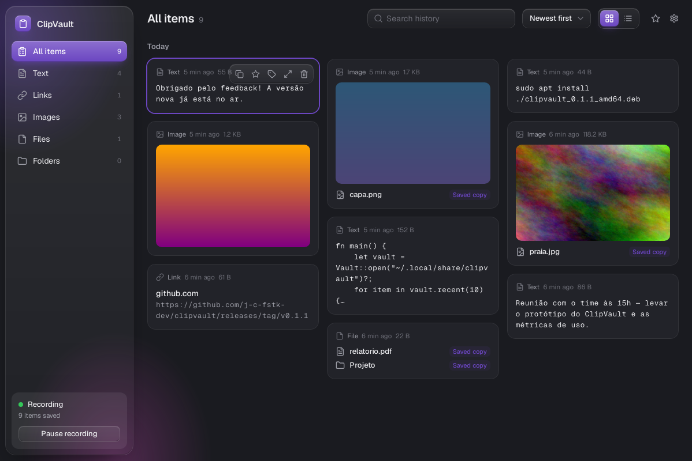
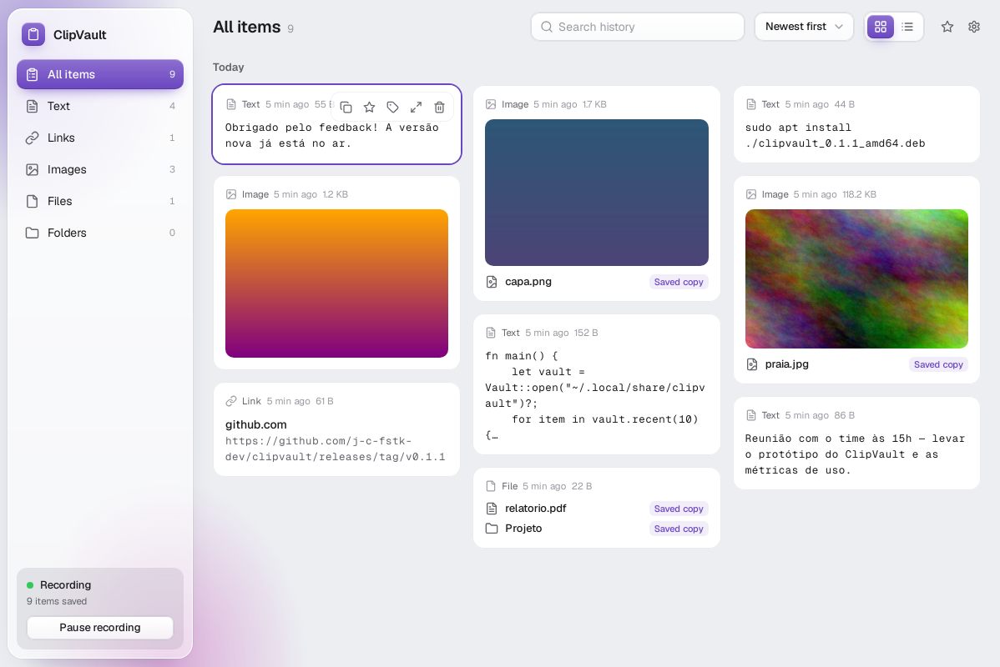
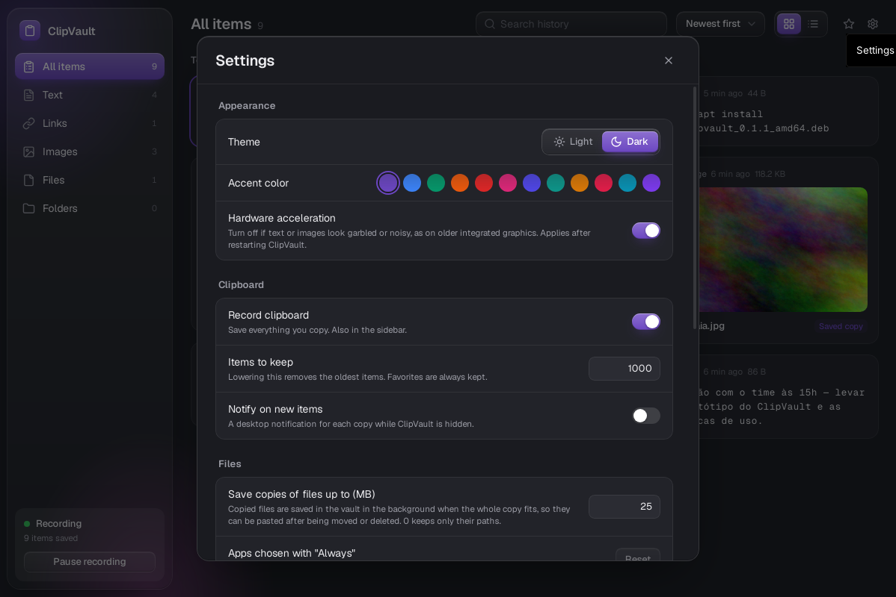

# 🧠 ClipVault

<div align="center">
  

  **Seu companheiro de memória**

  *Um gerenciador de área de transferência para Linux que lembra tudo o que você copia — textos, links, imagens, arquivos e pastas.*

  [English](README.md) · **Português**

  [](https://github.com/j-c-fstk-dev/clipvault/actions/workflows/ci.yml)
  [](https://github.com/j-c-fstk-dev/clipvault/releases)
  [](LICENSE)
  [](https://v2.tauri.app/)
  [](https://www.rust-lang.org/)
  [](https://react.dev/)

</div>

---

<p align="center">
  
</p>

> **Status:** em desenvolvimento ativo — a versão atual é a 0.2.1. Veja o
> [Changelog](CHANGELOG.md) (em inglês) e o [Roadmap](#-roadmap).

## ✨ Recursos

- **Captura em tempo real** no X11 — por eventos, sem varredura — de textos,
  HTML, imagens e arquivos/pastas copiados no gerenciador de arquivos
- **Cópias de arquivos** — os arquivos copiados também são guardados no cofre
  (até 25 MB por cópia, por padrão), em segundo plano e com baixa prioridade de
  disco, sem atrasar a sua própria cópia; cópias maiores guardam só o caminho
- **Segue arquivos recortados e movidos** — por 30 minutos depois de copiar, o
  ClipVault percebe quando um arquivo sai da pasta e descobre para onde ele foi
  (renomeado, colado em outro lugar, na lixeira ou num pendrive); arquivos
  movidos depois disso são procurados quando você os abre ou copia de novo
- **Abrir com** — clique num arquivo copiado para abri-lo; um seletor no estilo
  do Android mostra o app padrão primeiro e depois os outros apps instalados,
  com "Só desta vez" ou "Sempre"
- **Histórico persistente** em SQLite; copiar algo de novo leva o item para o
  topo em vez de duplicar; os mais antigos saem quando passa do limite
  (favoritos são sempre mantidos)
- **Copie qualquer coisa de volta** — textos (com formatação), imagens e
  arquivos que você cola direto no gerenciador de arquivos; se o original foi
  movido ou apagado, a cópia salva é colada no lugar
- **Privacidade** — conteúdo marcado como secreto por gerenciadores de senhas
  (como o KeePassXC) nunca é guardado, e a gravação pode ser pausada
- **Sempre à mão** — fica na bandeja; `Ctrl+Shift+V` (configurável) chama o app
  de qualquer lugar, as setas escolhem um item e `Ctrl+C` copia e sai da frente
  para você colar
- **Inicia com a sessão** (opcional), oculto na bandeja; notificações opcionais
  para novos itens
- **Backups** — exporte todo o histórico (com imagens e cópias de arquivos) para
  um `.zip` e importe em outra máquina; importar soma, nunca substitui
- **Categorias** — textos, links, imagens (inclusive arquivos de imagem do
  gerenciador de arquivos, com miniatura), arquivos e pastas, além de "Todos os
  itens"
- **Agrupado por dia** (Hoje, Ontem, …), numa grade que acomoda imagens e textos
  longos sem buracos, ou numa lista compacta; ordene por data ou nome; busca
  instantânea no conteúdo, nos caminhos de arquivo e nas etiquetas
- **Favoritos e etiquetas** para organizar o que importa
- **Visual inspirado no macOS** — barra lateral e barra de ferramentas de vidro,
  temas claro e escuro, 12 cores de destaque, fonte Geist. O vidro é desenhado
  sem desfoque, então continua nítido em placas de vídeo integradas antigas
- **Prévia** com detalhes e ações rápidas: copiar, favoritar, etiquetar, apagar
- **Inglês e português** — segue o idioma do sistema, ou escolha um nas
  Configurações (o menu da bandeja e as notificações acompanham)
- **Nativo e leve** — backend em Rust com o WebKitGTK do sistema, `.deb` pequeno

<p align="center">
  
  
</p>

### Teclado

| Teclas | Ação |
|---|---|
| `Ctrl+Shift+V` | Mostrar / ocultar o ClipVault de qualquer lugar |
| `↑` `↓` `←` `→` | Selecionar um item |
| `Enter` | Abrir a prévia do item selecionado |
| `Ctrl+C` | Copiar o item selecionado e ocultar o ClipVault |
| `Delete` | Apagar o item selecionado |
| `Esc` | Fechar a prévia, ou ocultar o ClipVault |

Os atalhos de mostrar/ocultar, copiar e apagar podem ser trocados nas
Configurações.

### Onde ficam os dados

| O quê | Caminho |
|---|---|
| Banco do histórico | `~/.local/share/com.jorgecristo.clipvault/clipvault.db` |
| Imagens e cópias de arquivos | `~/.local/share/com.jorgecristo.clipvault/blobs/` |
| Configurações | `~/.config/com.jorgecristo.clipvault/settings.json` |

## 📦 Instalação

Baixe o `.deb` ou o `.AppImage` mais recente na página de
[Releases](https://github.com/j-c-fstk-dev/clipvault/releases).

```bash
# Debian / Ubuntu / Kali
sudo apt install ./clipvault_<versão>_amd64.deb

# Qualquer distro
chmod +x clipvault_<versão>_amd64.AppImage
./clipvault_<versão>_amd64.AppImage

# Opcional: verifique o download (o SHA256SUMS vem em cada release)
sha256sum -c SHA256SUMS --ignore-missing
```

Por enquanto o foco são desktops **X11** (XFCE, MATE, Cinnamon, KDE no X11…).
O suporte a Wayland está no roadmap.

### Atualizando

Saia do ClipVault pelo menu da bandeja e instale o `.deb` novo do mesmo jeito;
ele atualiza por cima e mantém o histórico e as configurações. No AppImage, é
só trocar o arquivo antigo pelo novo.

### Solução de problemas

- **Texto com ruído ou distorcido** (comum em placas de vídeo integradas
  antigas): desligue *Configurações → Aparência → Aceleração de hardware* e
  reinicie o ClipVault.
- **Nada é gravado no Wayland:** por enquanto só apps X11 são capturados.

## 🛠️ Desenvolvimento

### Pré-requisitos

- [Rust](https://rustup.rs/) (stable)
- Node.js 20+ e npm
- Bibliotecas do sistema (Debian / Ubuntu / Kali):

```bash
sudo apt install libwebkit2gtk-4.1-dev libgtk-3-dev libayatana-appindicator3-dev \
  librsvg2-dev libxdo-dev libssl-dev build-essential curl wget file patchelf
```

### Rodar

```bash
npm install
npm run tauri dev       # app desktop com recarga automática
npm run tauri build     # .deb + .AppImage em src-tauri/target/release/bundle/
```

### Verificações (as mesmas do CI)

```bash
npm run lint && npm run build
cd src-tauri && cargo fmt --check && cargo clippy --all-targets -- -D warnings && cargo test
```

Os testes de integração da área de transferência (captura e colagem) precisam
de um servidor X e do `xclip`; sem eles, são pulados. Para rodar sem tela:
`sudo apt install xvfb xclip && xvfb-run -a cargo test`.

Use `RUST_LOG=clipvault_lib=debug` para logs detalhados do backend.

Os textos da interface ficam em `src/i18n/en.ts` e `src/i18n/pt.ts`; o
TypeScript avisa se faltar alguma tradução.

### Tecnologias

- **Backend:** Rust + [Tauri 2](https://v2.tauri.app/)
- **Interface:** React 18, TypeScript, Tailwind CSS, ícones Lucide, fontes Geist, Vite
- **Pacotes:** bundler do Tauri (`.deb`, `.AppImage`)

A estrutura do projeto está descrita no [README em inglês](README.md#project-structure).

## 📋 Roadmap

- [x] **Etapa 1 — Base:** app Tauri 2, AGPL-3.0, CI
- [x] **Etapa 2 — Núcleo:** captura X11 (texto, HTML, imagens, arquivos), sem duplicatas, histórico em SQLite, cópias de arquivos, filtro de gerenciadores de senhas
- [x] **Etapa 3 — Interface:** dados reais, copiar de volta em qualquer formato, configurações persistentes
- [x] **Etapa 4 — Sistema:** bandeja, atalho global, início automático, notificações
- [x] **Etapa 5 — Backup:** exportar / importar `.zip` com mesclagem
- [x] **Etapa 6 — Releases:** tag → Release no GitHub com `.deb` + `.AppImage`
- [x] **0.1.1:** abrir com, seguir arquivos movidos, cópias em segundo plano, arquivos de imagem como imagens
- [x] **0.2.0:** novo visual inspirado no macOS
- [x] **0.2.1:** rolagem suave nas janelas, inglês e português
- [ ] **Depois:** `.rpm`, Flatpak, AUR, Wayland, atualização automática, sincronização na nuvem (planos pagos)

## 🤝 Contribuindo

Veja o [CONTRIBUTING.md](CONTRIBUTING.md). Mantenedores: veja o
[RELEASING.md](RELEASING.md) para publicar uma versão e o
[CHANGELOG.md](CHANGELOG.md) para o histórico de mudanças.

## 📄 Licença

O ClipVault é software livre, licenciado sob a
[GNU Affero General Public License v3.0](LICENSE).

---

<div align="center">

  *Seu companheiro de memória está sempre cuidando da sua área de transferência* 🧠✨

</div>
